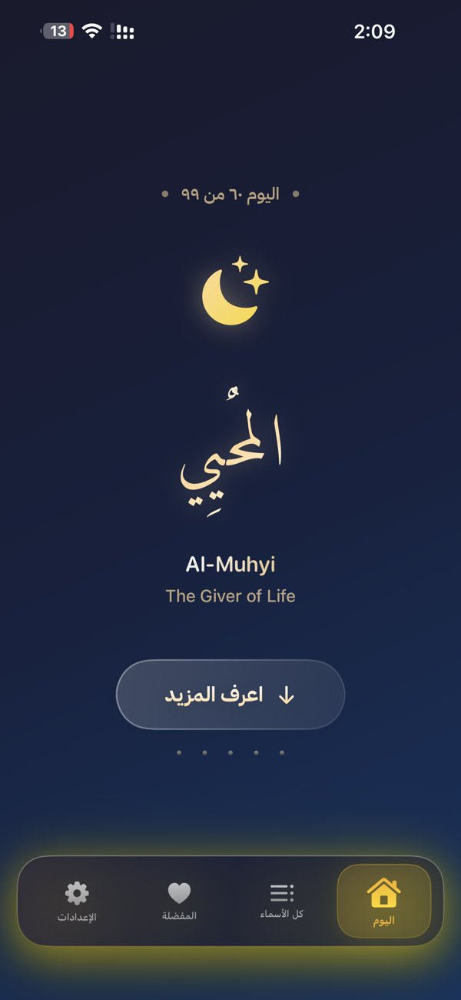
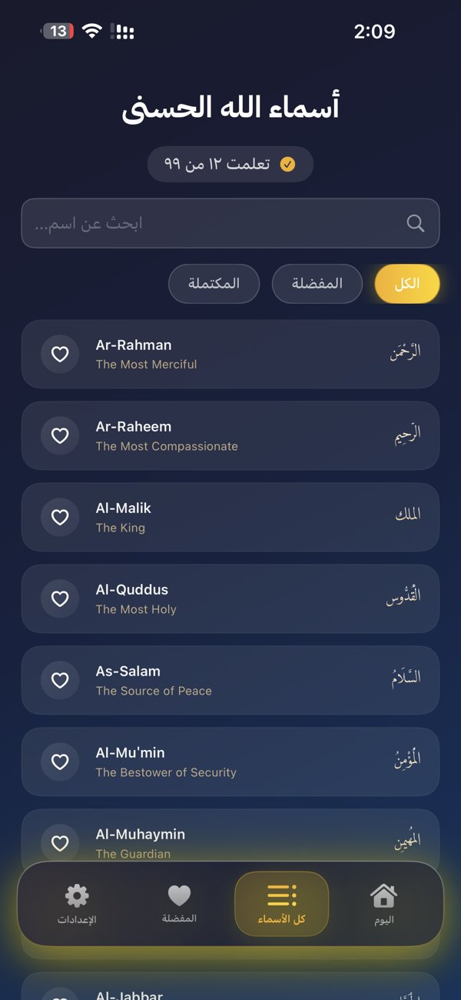

# Names of Allah | أسماء الله الحسنى

An iOS app for learning and living the 99 Names of Allah, one name a day.

> Previously published on the App Store.

  
  
  
  
  

## Features

- **Name of the day** with progress through all 99 names
- **Meaning, evidence and reflection** for every name, with the related Quranic verse
- **Practical steps** to live by each name, with a checklist to mark them done
- **Search and filters** across all names, learned names and favorites
- **Daily reminder** notifications
- **Themes** and full Arabic right-to-left interface

## Tech Stack

Swift · SwiftUI · WidgetKit · Local Notifications

- Home screen widget showing the name of the day
- Onboarding flow, favorites, sharing and settings
- All 99 names stored locally in `NamesData.json`
- Fonts: IBM Plex Sans Arabic and Diwan Mishafi

## Run

1. Open `NamesOfAllah.xcodeproj` in Xcode
2. Choose your own development team under Signing & Capabilities for the app and widget targets
3. Run on an iPhone or simulator with iOS 17 or later

## Author

**Abdulaziz Alfahad** · [github.com/8cy7](https://github.com/8cy7)
